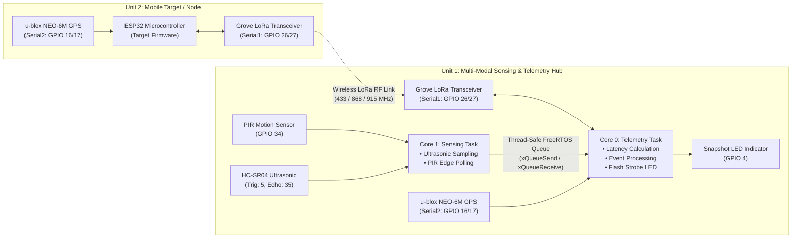
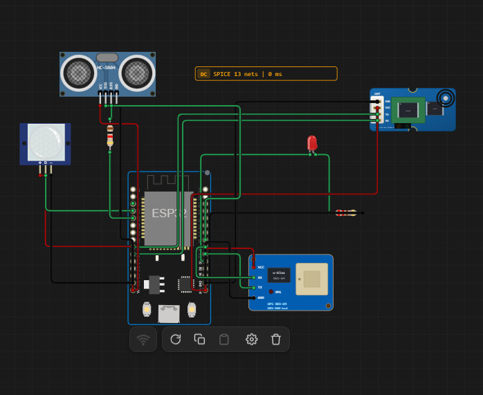
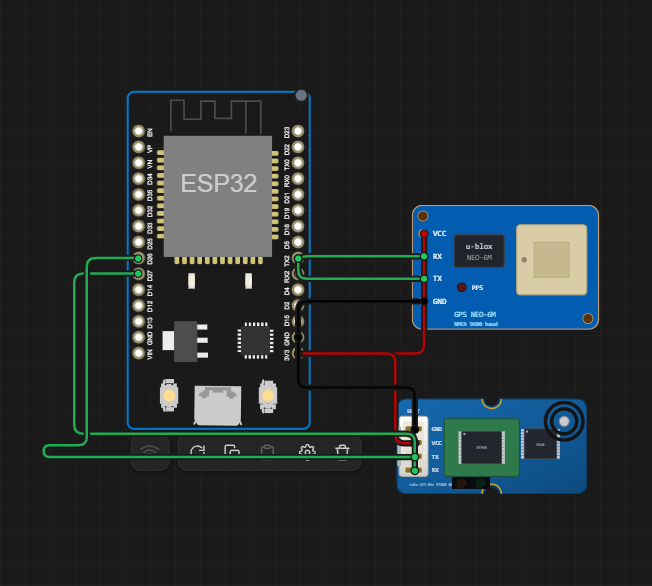

# A Low-Cost Multi-Modal Sensing-and-Telemetry Testbed for ISAC Proof-of-Concept Studies: Hardware Design, Firmware, and Field Evaluation

This repository presents the design, dual-core FreeRTOS firmware, schematics, and experimental configuration for a low-cost, open-hardware multi-modal sensing and long-range telemetry testbed engineered for **Integrated Sensing and Communication (ISAC)** proof-of-concept experiments and field validations.

---

## 📌 Table of Contents
- [Overview](#overview)
- [System Architecture](#system-architecture)
- [Hardware Schematics & Pin Mapping](#hardware-schematics--pin-mapping)
  - [Unit 1: Multi-Modal Sensing & Telemetry Hub](#unit-1-multi-modal-sensing--telemetry-hub)
  - [Unit 2: Mobile Target & GPS Telemetry Node](#unit-2-mobile-target--gps-telemetry-node)
- [Firmware Architecture](#firmware-architecture)
  - [Unit 1: Dual-Core FreeRTOS Concurrency](#unit-1-dual-core-freertos-concurrency)
  - [Unit 2: Real-Time GPS & LoRa Pipeline](#unit-2-real-time-gps--lora-pipeline)
- [Bill of Materials (BOM)](#bill-of-materials-bom)
- [Simulation & Reproduction](#simulation--reproduction)
- [License](#license)

---

## 🔬 Overview

Integrated Sensing and Communication (ISAC) is an emerging paradigm for 6G and next-generation IoT systems wherein radar/environmental sensing and wireless data communication share identical physical infrastructure, spectrum, and processing pipelines.

This repository provides an accessible, empirical hardware testbed composed of two autonomous units:
1. **Unit 1 (Base Hub / Sensing Station):** Deploys dual-core ESP32 microcontrollers executing symmetric multi-processing via FreeRTOS. Core 1 acquires high-frequency ultrasonic time-of-flight (HC-SR04) and PIR pyroelectric motion sensor data. Core 0 manages low-latency telemetry queuing, optical flash event capture (`CAM_LED_PIN`), GPS spatial logging, and LoRa wireless communication.
2. **Unit 2 (Mobile Target / Remote Node):** Emulates a dynamic mobile target instrumented with a u-blox NEO-6M GNSS module and a Grove/E32 UART LoRa transceiver, continuously transmitting spatio-temporal ground-truth telemetry to validate cooperative tracking and communication link performance.

---

## 📐 System Architecture

---

## 🔌 Hardware Schematics & Pin Mapping

### Unit 1: Multi-Modal Sensing & Telemetry Hub

Unit 1 serves as the static sensor hub and telemetry processing server.

#### Unit 1 Pinout Table
| Peripheral | Pin Name | ESP32 GPIO | Description |
|---|---|---|---|
| **HC-SR04 Ultrasonic** | `TRIG` | `GPIO 5` | Ultrasonic trigger pulse output (10 µs) |
| **HC-SR04 Ultrasonic** | `ECHO` | `GPIO 35` | Echo return pulse input (with voltage divider) |
| **PIR Motion Sensor** | `OUT / D` | `GPIO 34` | Digital pyroelectric motion detection input |
| **Alert / Snapshot Flash** | `Anode (+)` | `GPIO 4` | Snapshot flash LED indicator (300 ms pulse) |
| **u-blox NEO-6M GPS** | `TX` | `GPIO 16` | Hardware Serial 2 RX (`GPS_RX_PIN`) |
| **u-blox NEO-6M GPS** | `RX` | `GPIO 17` | Hardware Serial 2 TX (`GPS_TX_PIN`) |
| **Grove / E32 LoRa** | `TX` | `GPIO 26` | Hardware Serial 1 RX (`LORA_RX_PIN`) |
| **Grove / E32 LoRa** | `RX` | `GPIO 27` | Hardware Serial 1 TX (`LORA_TX_PIN`) |

---

### Unit 2: Mobile Target & GPS Telemetry Node

Unit 2 acts as the mobile ground-truth reference platform transmitting dynamic GPS positioning data over long-range wireless links.

#### Unit 2 Pinout Table
| Peripheral | Pin Name | ESP32 GPIO | Description |
|---|---|---|---|
| **u-blox NEO-6M GPS** | `TX` | `GPIO 16` | Hardware Serial 2 RX (`GPS_RX_PIN`) |
| **u-blox NEO-6M GPS** | `RX` | `GPIO 17` | Hardware Serial 2 TX (`GPS_TX_PIN`) |
| **Grove / E32 LoRa** | `TX` | `GPIO 26` | Hardware Serial 1 RX (`LORA_RX_PIN`) |
| **Grove / E32 LoRa** | `RX` | `GPIO 27` | Hardware Serial 1 TX (`LORA_TX_PIN`) |
| **Power Supply** | `VCC / GND`| `3V3 / GND`| 3.3V power rails from ESP32 regulator |

---

## 💻 Firmware Architecture

### Unit 1: Dual-Core FreeRTOS Concurrency
The Unit 1 firmware is located at [`firmware/unit1_sensing_hub/unit1_sensing_hub.ino`](firmware/unit1_sensing_hub/unit1_sensing_hub.ino).
- **Core Isolation:** Sensor polling runs on **Core 1**, completely isolating blocking timing operations (`pulseIn`) from high-priority communication routines on **Core 0**.
- **Emulator & Hardware Safe:** Replaces hardware interrupt collisions in simulated environments with edge-detecting state polling over FreeRTOS ticks.
- **Latency Instrumentation:** Microsecond-accurate timestamps (`micros()`) are packaged within each `SensorEvent` struct, enabling empirical evaluation of inter-task queue latency:
  $$\text{Latency} = t_{\text{processed}} - t_{\text{acquired}}$$

### Unit 2: Real-Time GPS & LoRa Pipeline
The Unit 2 firmware is located at [`firmware/unit2_lora_target/unit2_lora_target.ino`](firmware/unit2_lora_target/unit2_lora_target.ino).
- Employs dedicated hardware UART peripherals (`Serial1` and `Serial2`) to eliminate software serial overhead and jitter.
- Streams raw NMEA GPS sentences (`$GPGGA`, `$GPRMC`) directly into the RF transmission buffer for low-overhead field propagation.

---

## 📦 Bill of Materials (BOM)

| Component | Quantity | Specification / Description | Approximate Unit Cost |
|---|---|---|---|
| **ESP32 DevKit V1** | 2 | 30-pin Dual-Core Tensilica Xtensa 32-bit LX6 | ~$4.00 |
| **u-blox NEO-6M GPS** | 2 | High-sensitivity GNSS receiver with ceramic patch antenna | ~$3.50 |
| **Grove / E32 LoRa Module** | 2 | 433/868/915 MHz UART Wireless Transceiver | ~$6.00 |
| **HC-SR04 Ultrasonic Sensor** | 1 | 2 cm – 400 cm ranging sensor | ~$1.20 |
| **PIR Motion Sensor (HC-SR501)**| 1 | Passive infrared motion detector | ~$1.00 |
| **LED + Resistor Pack** | 1 | 5mm Diffused Red LED + 220Ω / 1kΩ resistors | ~$0.30 |
| **Connecting Jumpers / Breadboard** | 2 | Breadboards & DuPont jumper wire set | ~$2.00 |

*Total Hardware Testbed Cost:* **< $30.00 USD**

---

## 🚀 Simulation & Reproduction

### Running on Physical Hardware
1. Install [Arduino IDE](https://www.arduino.cc/en/software) or [PlatformIO](https://platformio.org/).
2. Add ESP32 board support via the ESP32 Board Manager URL:
   `https://raw.githubusercontent.com/espressif/arduino-esp32/gh-pages/package_esp32_index.json`
3. Connect Unit 1 to USB and upload [`firmware/unit1_sensing_hub/unit1_sensing_hub.ino`](firmware/unit1_sensing_hub/unit1_sensing_hub.ino).
4. Connect Unit 2 to USB and upload [`firmware/unit2_lora_target/unit2_lora_target.ino`](firmware/unit2_lora_target/unit2_lora_target.ino).
5. Open Serial Monitors at `115200 baud` to view real-time latency logs and telemetry transmissions.

### Running on Wokwi Simulator
Both schematics are 100% compatible with Wokwi ESP32 simulations. Copy the firmware into the `sketch.ino` window and connect the pins matching the schematics in `docs/hardware_schematics/`.

---

## 📄 License
This project is open-source under the [MIT License](LICENSE).
